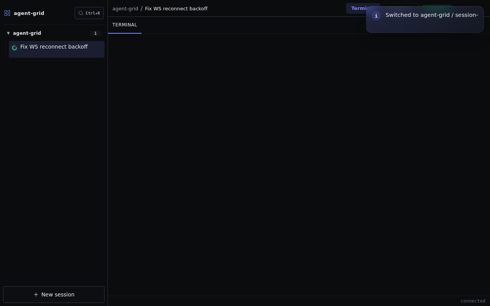

# Agent Grid

**Run, supervise, and automate AI coding agents across projects, hosts, and sandboxes.**

Agent Grid is a control plane for Claude, Codex, Gemini, and other terminal-based
agents. It keeps concurrent sessions visible and reachable, preserves them when a
client disconnects, and can dispatch unattended work from an issue tracker.



## Why Agent Grid

- **Supervise every session in one place.** See which agents are running, idle,
  waiting for input, or awaiting approval.
- **Resume work instantly.** Preview a live terminal and take control without
  finding the right tab, shell, host, or project again.
- **Keep sessions alive.** The backend owns the PTYs, so agents continue running
  when a browser or desktop client disconnects.
- **Isolate projects safely.** Optional per-project devcontainers use brokered
  AWS, gcloud, and SSH access; long-lived credentials remain on the host.
- **Automate issue-driven work.** The orchestrator reads `WORKFLOW.md`, polls
  Linear or GitHub, dispatches agents, and reconciles their progress.

## Quick start

The quickest way to try the Web client from a source checkout is:

```bash
make run-dev
```

This builds and starts an isolated local backend and Web host. Open the URL
printed by the command (normally `http://127.0.0.1:8080`).

Prerequisites for the development stack:

- Go 1.26.1 or newer
- Node.js and npm
- Linux or WSL
- Docker when using per-project devcontainers
- At least one supported agent CLI, such as Claude Code, Codex, or Gemini CLI

For persistent installation and service setup, follow
[Getting started](docs/note/note-20260624-user-getting-started.md) and
[systemd setup](docs/note/note-20260624-user-systemd.md).

## Surfaces

| Surface | Role | Status |
|---|---|---|
| **Web** | Shared React/xterm.js UI served by an independent Web host | Available |
| **Windows Shell** | Native WinUI panel, notifications, tray, and deep links | In development |
| **Workspace** | Electron-hosted session windows using the shared UI | In development |
| **Orchestrator** | Headless `WORKFLOW.md` scheduler for issue-driven agents | Available |

Web and Electron are equal client hosts. Both use the same multi-server
configuration and server-qualified session identity; only their delivery
transport differs.

## Architecture

Agent Grid separates session supervision from autonomous orchestration:

```text
Web / Windows Shell / Electron Workspace
                 │
                 ▼
       server (HTTP/WS + PTY sessions)
                 │
        agent CLIs and sandboxes

orchestrator ──► issue tracker + per-issue workspaces
```

The main deployables are:

- **`server`** — single-process PTY session daemon and HTTP/WebSocket gateway
- **`web-host`** — configured host for the shared browser UI
- **`orchestrator`** — issue polling, dispatch, reconciliation, and observability
- **`claude-app-server`** — stdio JSON-RPC adapter that exposes Claude through
  the Codex app-server contract

Go services live in the independent `services/` module. User-facing clients and
their hosts live under `clients/`. See [ARCHITECTURE.md](ARCHITECTURE.md) for
enforced layer and dependency boundaries.

## Documentation

| Audience | Start here |
|---|---|
| Using Agent Grid | [User guide](docs/note/note-20260624-user-overview.md) |
| Installing and launching | [Getting started](docs/note/note-20260624-user-getting-started.md) |
| Running unattended agents | [Orchestrator guide](docs/note/note-20260624-user-orchestrator.md) |
| Contributing | [Contributor guide](docs/note/note-20260624-agent-contributing.md) |
| Understanding internals | [Technical overview](docs/note/note-20260624-technical-overview.md) |

Optional Codex mobile access is documented in
[Codex Remote Control](docs/note/note-20260715-user-codex-remote-control.md).

## Development

Common verification commands:

```bash
make vet
cd services && go test ./...
cd clients/ui && npm run test:unit
```

See [AGENTS.md](AGENTS.md) and the
[testing guide](docs/note/note-20260624-agent-testing.md) for the complete
test-tier and contribution rules.

## License

[MIT](LICENSE)
