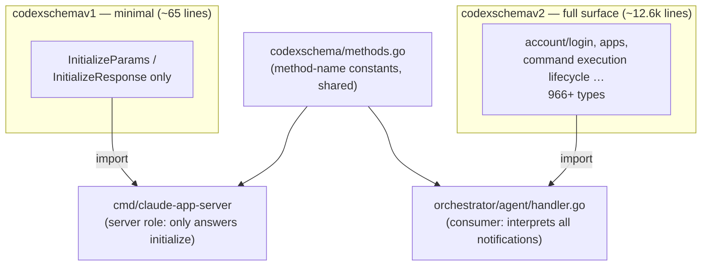
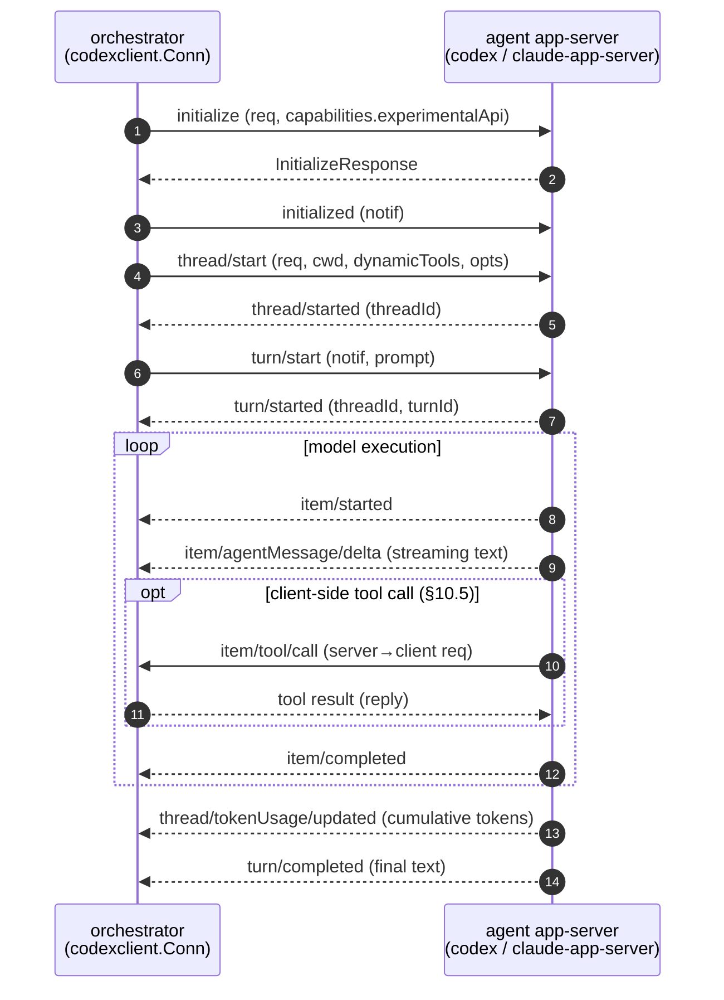
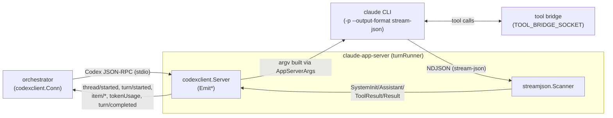
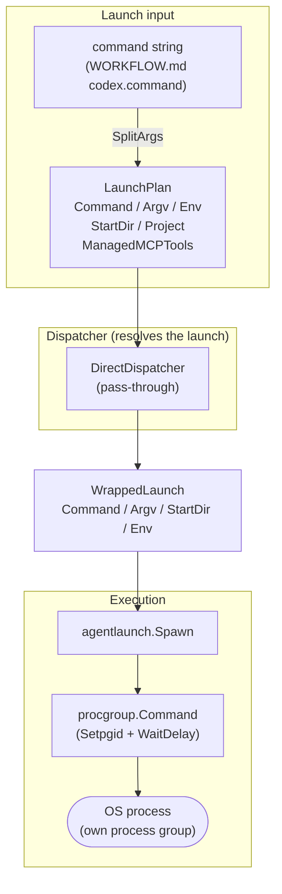
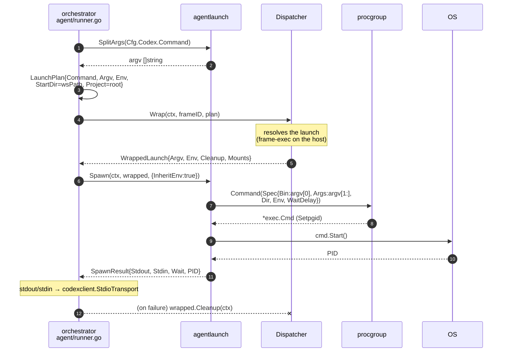
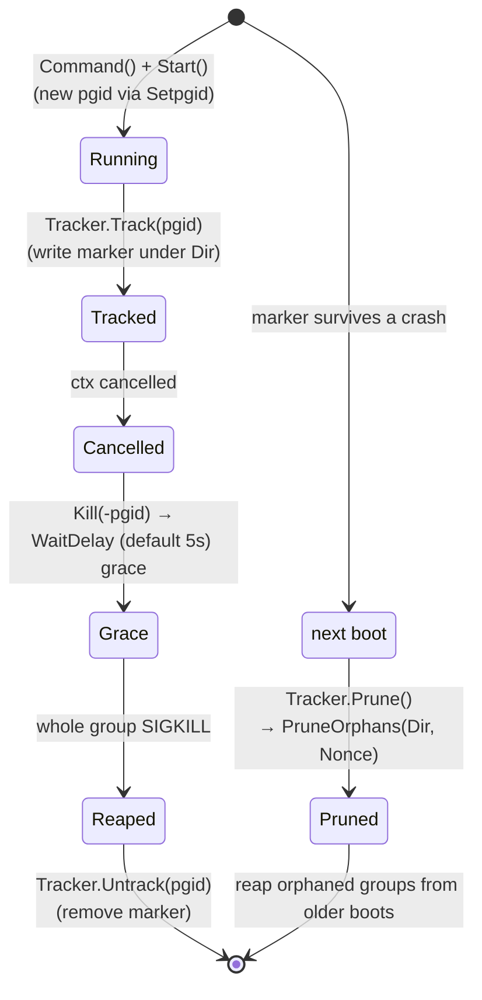

# Platform architecture

The platform area is the shared infrastructure boundary below product policy. It standardizes process launch, terminal fan-out, and the agent protocol. Frame launch owns final PATH ordering after pre-exec evaluation; stable platform identities define authoritative shim locations.

The complete legacy sources remain below as migration history. The governing contract above is the maintained design surface.

## Legacy Source: component-20260624-platform-agent-protocol

````markdown
---
id: component-20260624-platform-agent-protocol
kind: component
title: Agent Protocol — The Codex app-server Protocol Layer
status: active
created: '2026-06-24'
updated: '2026-07-04'
tags:
- technical
- platform
- legacy-import
owners: []
relations:
- {type: referencedBy, target: component-20260624-orchestrator-overview}
- {type: references, target: component-20260624-orchestrator-overview}
- {type: references, target: component-20260624-platform-spawn-and-launch}
- {type: referencedBy, target: component-20260624-platform-overview}
- {type: referencedBy, target: component-20260624-platform-spawn-and-launch}
- {type: referencedBy, target: note-20260624-technical-guardrails}
- {type: referencedBy, target: note-20260624-technical-overview}
source_paths:
- services/platform/agent/codexclient/
- services/platform/agent/codexschema/
- services/platform/lib/codex/
- services/platform/lib/claude/
- services/platform/agent/codexschema/README.md
- services/cmd/claude-app-server/
- services/orchestrator/agent/handler.go
- services/cmd/claude-app-server/main.go
provides:
- agent-protocol-the-codex-app-server-protocol-layer
summary: The shared stdio JSON-RPC protocol the orchestrator uses to drive an agent
  (Codex / Claude). This layer is what lets the scheduler stay agent-agnostic — Codex
  and Claude emit the same event sequence, so nothing above
---

<!-- migrated_from: docs/technical/platform/agent-protocol.md -->

# Agent Protocol — The Codex app-server Protocol Layer

The shared **stdio JSON-RPC protocol** the orchestrator uses to drive an agent (Codex / Claude). This layer is what lets the scheduler stay **agent-agnostic** — Codex and Claude emit the same event sequence, so nothing above has to branch on the agent.

| Package | Responsibility |
|---|---|
| `platform/agent/codexclient/` | Transport-agnostic JSON-RPC framing; helpers for both the client and server roles |
| `platform/agent/codexschema/` | Protocol method-name constants + generated types (v1/v2), pinned to a JSON Schema |
| `platform/lib/codex/` | argv builders for launching the codex process |
| `platform/lib/claude/` | Claude CLI integration (`cli/` argv builders, `streamjson/` output parser) |

The launch path (how it becomes a process) is in [spawn-and-launch.md](../component/component-20260624-platform-spawn-and-launch.md); the scheduler-side usage is in the [orchestrator README](../component/component-20260624-orchestrator-overview.md).

## codexclient — JSON-RPC framing

`Conn` (`codexclient/conn.go:33`) is the hub that routes JSON-RPC messages.

- `Request(method, params)` (`conn.go:83`) — a client→server request that awaits a response
- `Notify(method, params)` (`conn.go:111`) — a notification, no response expected
- `Run(ctx, Handler)` (`conn.go:56`) — the receive loop; dispatches to the `Handler`'s `OnNotification` / `OnServerRequest` (`conn.go:23-27`)

**Client-role** helpers (`client.go`): `Initialize` performs the `initialize` request + `initialized` notification handshake and sends `capabilities: {experimentalApi: true}` (`client.go:11`). `StartThread` (advertises the `§10.5` dynamicTools), `StartTurn`, and `ResumeThread` build their respective requests.

**Server-role** helpers (`server.go`): `Server` provides notification emitters — `EmitThreadStarted` / `EmitTurnStarted` / `EmitTurnCompleted` / `EmitAgentMessageDelta` / `EmitItemStarted` / `EmitItemCompleted` / `EmitTokenUsage` (`server.go:25-85`). The `claude-app-server` shim uses these to "speak" the Codex protocol.

There are two transports: stdio (`transport_stdio.go`) and websocket (`transport_ws.go`).

## codexschema — method constants and versioned types

`methods.go` (package `codexschema`) holds the protocol method names in four groups:

| Group | Examples |
|---|---|
| client→server requests | `initialize` / `thread/start` / `thread/resume` |
| client→server notifications | `initialized` / `turn/start` |
| server→client notifications | `thread/started` / `turn/started` / `item/started` / `item/agentMessage/delta` / `item/completed` / `thread/tokenUsage/updated` / `turn/completed` / `error` … |
| server→client requests | `item/commandExecution/requestApproval` / `item/fileChange/requestApproval` / `item/tool/call` (§10.5) / `item/tool/requestUserInput` (experimental) |

> Documented posture for `item/tool/requestUserInput`: automated orchestration treats it as a hard fail (`methods.go:47`).

Types are generated from JSON Schema by quicktype into `v1/types.gen.go` (package `codexschemav1`) and `v2/types.gen.go` (package `codexschemav2`). These are **pinned** to a specific codex-cli version and verified by a CI drift check (`make codex-schema-check`) that diffs the committed bundles against current codex output. A schema bump requires an explicit PR that updates the pin and regenerates types (details in `platform/agent/codexschema/README.md`). The generated files are auto-excluded from the lint file/function-length checks.

### v1 / v2 — selected at import time

The two differ only in type coverage; **there is no runtime negotiation**. `initialize` sends `experimentalApi: true`, but which type set is used is decided by the **consumer's import choice**.



- `claude-app-server` only returns `initializeResponse()`, so the minimal **v1** suffices (`cmd/claude-app-server/main.go:12`).
- The orchestrator's `turnHandler` interprets `thread/started`, `turn/completed`, `tokenUsage`, etc., so it imports **v2** plus the shared `codexschema` constants (`orchestrator/agent/handler.go:13-14`).

## The agent turn sequence

The orchestrator's `agent/runner.go:launchConn` opens a `Conn`, and the `turnHandler` (`handler.go`) receives notifications.



`turnHandler.OnNotification` (`handler.go:67`) signals `sessionReady` on `turn/started` and `turnDone` on `turn/completed`, measures the turn duration, and reports a `CodexActivity` to metrics. It auto-replies `acceptForSession` to `item/*/requestApproval` (`handler.go:170`).

## Presenting Claude as the Codex protocol — the claude-app-server shim

Claude has no native app-server, so `cmd/claude-app-server` acts as a **drop-in shim** that speaks the Codex protocol while internally launching the Claude CLI and translating its stream-json output.



- `cli/argv.go`'s `AppServerArgs(resumeSessionID, appendSystemPrompt, prompt)` (`:29`) builds argv like `-p --output-format stream-json --verbose --resume <id>`.
- `streamjson` (`streamjson.go`) parses the CLI's NDJSON into typed events (`SystemInit` / `AssistantMessage` / `ToolResult` / `ToolResults` / `Result` / `Unknown`). `Usage.Total()` returns the token total.
- `turnRunner.scanStream` (`turn.go:170`) translates events into Codex notifications: `SystemInit` → record sessionID, `AssistantMessage` → `EmitAgentMessageDelta`, `ToolResult` → `item/completed`, `Result` → `completeTurn` (which emits `EmitTokenUsage` + `turn/completed`).
- Claude's tool execution is forwarded to an in-band tool bridge over `TOOL_BRIDGE_SOCKET` (`turn.go:99`).

approval / sandbox policy hints are logged but not enforced by the shim.

## lib/codex — argv builders for codex

`lib/codex/argv.go` builds the process-launch argv:

| Function | Purpose |
|---|---|
| `ParseCommand(argv []string)` (`:26`) | Parse `codex.command` into a `CommandConfig` |
| `AppServerListenArgs(serverBin, sock, extra)` (`:54`) | listen-socket mode |
| `AppServerStdioArgs(extra)` (`:64`) | stdio mode |
| `RemoteAttachArgs(sock, threadID, startDir)` (`:79`) | remote attach over the app-server UDS (`--remote unix://<sock>`) |
| `ShellJoinArgv(args)` (`:93`) | shell-join argv for a pty frame |

`ShellJoinArgv` is what populates the `Command` form (pty frame) in [spawn-and-launch.md](../component/component-20260624-platform-spawn-and-launch.md).

````

## Legacy Source: component-20260624-platform-overview

````markdown
---
id: component-20260624-platform-overview
kind: component
title: platform/ — Shared Infrastructure
status: active
created: '2026-06-24'
updated: '2026-07-04'
tags:
- technical
- platform
- legacy-import
owners: []
relations:
- {type: references, target: component-20260624-platform-agent-protocol}
- {type: references, target: component-20260624-platform-spawn-and-launch}
- {type: references, target: note-20260624-technical-code-enforcement}
- {type: references, target: note-20260624-technical-guardrails}
- {type: referencedBy, target: note-20260624-agent-overview}
- {type: referencedBy, target: note-20260624-docs-overview}
- {type: referencedBy, target: note-20260624-technical-code-enforcement}
- {type: referencedBy, target: note-20260624-technical-overview}
source_paths:
- services/platform/logger/
- services/platform/lib/
- services/platform/tracker/
- services/platform/metrics/
provides:
- platform-shared-infrastructure
summary: platform/ is the base layer. Both the server backend (client/) and the orchestrator/
  depend on it; it depends on neither of them (enforced by the depguard rule platform-no-host-or-orchestrator).
  Wire-format and
---

<!-- migrated_from: docs/technical/platform/README.md -->

# platform/ — Shared Infrastructure

`platform/` is the base layer. Both the `server` backend (`client/`) and the `orchestrator/` depend on it; it depends on **neither** of them (enforced by the `depguard` rule `platform-no-host-or-orchestrator`). Wire-format and persistence types here stay stdlib-only.

Because it sits below both services, `platform/` is where tool-specific knowledge (paths, env var names, CLI invocations) is allowed to live — keeping it out of the generic layers above.

## Design principles (platform realization)

`platform/` is a **library layer, not a decision loop**, so the Functional Core / Imperative Shell form of the [core principles](../../../ARCHITECTURE.md#core-principles-all-layers) does not apply here. It still serves the same overriding goal — **testability** — but through **dependency-injection seams** rather than a pure reducer:

- **Testability via DI seams** — code that wraps an external dependency (`exec`, docker, the network, a filesystem path) puts that dependency behind an injectable interface or an env-var override, so tests substitute a fake. Examples: subprocess wrappers expose a `Runner` interface (`lib/github.Runner`) with a `DefaultRunner` for production and a fake for tests; external config paths accept overrides (`CODEX_CONFIG_DIR`). "We can't test it without the real binary" is a design defect — cover the parsing/command-assembly logic behind the seam.
- **Base layer, no upward imports** — `platform/` imports neither `client/` nor `orchestrator/` (enforced by `depguard` rule `platform-no-host-or-orchestrator`). It knows nothing about the services above it.
- **Tool-specific knowledge concentrated here** — paths, env-var names, and CLI invocations live in `lib/<tool>/` so the generic layers above stay tool-agnostic. This is the receiving side of client's Driver isolation.
- **Agent-agnostic launch primitive** — `agentlaunch` (`Spawn`/`SplitArgs`/`Dispatcher`) turns a command string into a running process without knowing which agent it launches; per-agent argv construction stays in `lib/<tool>`.
- **Wire-format / persistence is stdlib-only** — types that cross the wire or hit disk depend only on the standard library, for portability.

## Packages

| Package | Responsibility |
|---|---|
| `platform/logger/` | `slog` initialization + log file management. |
| `platform/lib/` | External tool integration — `git`, `github`, `gemini`, `wsl`, `openurl`, `notify`, …  Per-agent argv builders: `lib/codex/argv.go` (`AppServerListenArgs`, `RemoteAttachArgs`, `ParseCommand([]string)`, `ShellJoinArgv`, driver constants) and `lib/claude/cli/argv.go` (`AppServerArgs`). |
| `platform/tracker/` | Issue tracker adapters (e.g. `linear/`). Shared by the orchestrator. |
| `platform/metrics/` | Token / runtime metrics accumulation. |
| `platform/agentlaunch/` | Agent launch primitives: `LaunchPlan`/`WrappedLaunch` (dual `Command` string for pty frame + `Argv []string` for `Spawn`), `Dispatcher.Wrap` interface, `Spawn` (argv-direct exec via `procgroup`, no host shell), `SplitArgs` POSIX tokenizer. Shared by client and orchestrator. |
| `platform/procgroup/` | Process-group spawn wrapper (`procgroup.Command`) with `WaitDelay`-bounded SIGKILL. `Tracker` records pgids so a future boot's `PruneOrphans` can reap orphaned processes. |
| `platform/agent/` | Shared agent launch interfaces (e.g. `codexclient/`). |

## Per-subsystem deep dives

- **[spawn-and-launch.md](../component/component-20260624-platform-spawn-and-launch.md)** — `agentlaunch` + `procgroup`. The layer that turns a command string into a running process: `LaunchPlan`/`WrappedLaunch`/`Dispatcher`/`Spawn`, process-group lifecycle and orphan reaping.
- **[agent-protocol.md](../component/component-20260624-platform-agent-protocol.md)** — `agent/codexclient` + `codexschema` (v1/v2) + `lib/codex` + `lib/claude`. The Codex app-server stdio protocol, the turn sequence, and the claude-app-server shim's translation.
- Agent-control guardrails (autonomy policy, concurrency, liveness) are in [guardrails.md](../note/note-20260624-technical-guardrails.md); code-level enforcement (import boundaries, length limits) is in [code-enforcement.md](../note/note-20260624-technical-code-enforcement.md).

````

## Legacy Source: component-20260624-platform-spawn-and-launch

````markdown
---
id: component-20260624-platform-spawn-and-launch
kind: component
title: Spawn & Launch — Centralized Agent Process Launching
status: active
created: '2026-06-24'
updated: '2026-07-04'
tags:
- technical
- platform
- legacy-import
owners: []
relations:
- {type: referencedBy, target: component-20260624-orchestrator-overview}
- {type: referencedBy, target: component-20260624-platform-agent-protocol}
- {type: referencedBy, target: component-20260624-platform-overview}
- {type: references, target: component-20260624-platform-agent-protocol}
- {type: referencedBy, target: note-20260624-technical-guardrails}
- {type: referencedBy, target: note-20260624-technical-overview}
source_paths:
- services/platform/agentlaunch/
- services/platform/procgroup/
- WORKFLOW.md
- services/host/state/
provides:
- spawn-launch-centralized-agent-process-launching
summary: The platform/ layer owns the single answer to "how does a command string
  become a running process?". Centralized out of client/ and orchestrator/ by the
  recent "platform spawn/command centralization" work, three
---

<!-- migrated_from: docs/technical/platform/spawn-and-launch.md -->

# Spawn & Launch — Centralized Agent Process Launching

The `platform/` layer owns the single answer to **"how does a command string become a running process?"**. Centralized out of `client/` and `orchestrator/` by the recent "platform spawn/command centralization" work, three packages cooperate here.

| Package | Responsibility |
|---|---|
| `platform/agentlaunch/` | Launch specs (`LaunchPlan`/`WrappedLaunch`), launch resolution (`Dispatcher`), argv-direct exec (`Spawn`), POSIX tokenizer (`SplitArgs`) |
| `platform/procgroup/` | Process-group lifecycle (`Command`), orphan reaping (`Tracker`) |

The agent protocol spoken over the spawned stdio is in [agent-protocol.md](../component/component-20260624-platform-agent-protocol.md).

## Core design: two launch forms and shell-less exec

A launch spec carries **two forms at once** (`agentlaunch/types.go`).

- `Command string` — a shell-joined string. Used by the **per-frame pty** launcher (the `server` backend, on top of `PtyBackend`).
- `Argv []string` — pre-tokenized argv. Used by **argv-direct exec** (orchestrator). Because **no `/bin/sh -c` is interposed on the host**, shell-metacharacter injection cannot occur by construction.

Per-agent lib builders (`lib/codex`, `lib/claude/cli` — see [agent-protocol.md](../component/component-20260624-platform-agent-protocol.md)) populate both; the caller chooses which to use.

### Managed MCP exposure

`platform/agentlaunch` owns the managed MCP endpoint catalog: alias, stdio
subcommand, collision posture, and frame-authority requirement. Host and
container paths resolve only the environment-specific executable and socket.
The host `LaunchPlan.ManagedMCPTools` contract is intentionally limited to
clients compatible with Claude's trailing inline `--mcp-config`; it is not a
universal product-capability flag.

Container provisioning uses the same catalog with an explicit container-scope
default set and materializes one read-only `.mcp.json` overlay per workspace.
It does not derive provisioning from a per-frame launch plan.
agentlaunch
composes those aliases with managed endpoints. Codex `dynamicTools` remains a
separate app-server protocol boundary.

## Types and relationships



### `LaunchPlan` → `WrappedLaunch`

`LaunchPlan` carries pure launch parameters (`types.go:11`).

`Dispatcher.Wrap` (`dispatcher.go:8`) resolves it into a `WrappedLaunch` (`types.go:32`).

### The Dispatcher implementation

| Implementation | Behaviour |
|---|---|
| `DirectDispatcher` (`direct.go`) | Resolves every launch through `<SelfBin> frame-exec`. Strips `AG_SOCKET_TOKEN` (`stripContainerOnlyEnv`) unless the launch needs frame-messaging authority; injects `AG_SOCKET` when configured |

## End-to-end launch sequence

The orchestrator's `agent/runner.go:launchConn` (`runner.go:305`) is the representative caller.



`Spawn` (`spawn.go:38`) errors immediately if `Argv` is empty. The environment is assembled by `buildEnv`: with `InheritEnv` true it merges onto `os.Environ()`, otherwise only the keys in `w.Env` (returning a non-nil empty slice even when empty, so os/exec does not inherit the parent environment). It wires stdout/stdin pipes and returns `SpawnResult` after `cmd.Start()`.

## procgroup: process-group lifecycle

Go's `exec.CommandContext` **only SIGKILLs the immediate child** on cancellation. Grandchildren the child spawned (an ssh-agent, a language server launched by an MCP shim, codex tool subprocesses…) get reparented to init and survive. `procgroup` places each command in its **own process group** (Linux: `Setpgid`) and kills the whole group on cancellation, reaping descendants together with the parent (`procgroup.go` package doc).



- `Command` (`procgroup.go:45`) — `WaitDelay` defaults to `DefaultWaitDelay = 5s` (`procgroup.go:28`). After `Cancel=Kill(-pgid)` it gives this grace window before os/exec force-closes I/O. Non-Linux degrades to `exec.CommandContext` defaults.
- `Tracker` (`procgroup.go:81`) — holds `Dir`/`Nonce` and records live pgids as marker files. `NewBootNonce` (`procgroup.go:69`) issues a per-boot token, so `Prune` (`procgroup.go:103`) only reaps orphans from **earlier** boots and never touches the current boot's groups. A nil Tracker / empty Dir is a no-op, so callers without crash-reaping configured need no branching.

## Callers

| Layer | Launch form | Path |
|---|---|---|
| orchestrator | `Argv` (argv-direct) | `agent/runner.go:launchConn` → `SplitArgs` → `Wrap` → `Spawn` |
| client (`server` backend) | `Command` (per-frame pty) | via `PtyBackend.SpawnFrame`; does not use `Spawn`, hands the command string to the per-frame pty session (ADR 0004) |
| claude-app-server | `Argv` | same lineage as the orchestrator's stdio shim (see [agent-protocol.md](../component/component-20260624-platform-agent-protocol.md)) |

````

## Legacy Source: component-20260624-platform-termvt-multiplexer-testing

````markdown
---
id: component-20260624-platform-termvt-multiplexer-testing
kind: component
title: 'termvt multiplexer: fan-out isolation test harness'
status: active
created: '2026-06-24'
updated: '2026-07-04'
tags:
- technical
- platform
- legacy-import
owners: []
relations:
- {type: referencedBy, target: adr-20260624-0003-termvt-fanout-isolation}
- {type: referencedBy, target: adr-20260624-0028-termvt-session-actor-model}
- {type: references, target: adr-20260624-0002-optin-appserver-e2e-validates-fakes}
- {type: references, target: adr-20260624-0003-termvt-fanout-isolation}
- {type: references, target: adr-20260624-0028-termvt-session-actor-model}
- {type: references, target: component-20260624-client-stream-backend-e2e}
- {type: references, target: component-20260624-client-stream-backend-testing}
- {type: referencedBy, target: note-20260624-agent-testing}
- {type: referencedBy, target: note-20260624-technical-code-enforcement}
source_paths:
- services/platform/termvt/
- services/server/api/
provides:
- termvt-multiplexer-fan-out-isolation-test-harness
summary: 'platform/termvt is the PTY multiplexer primitive: it runs a command in a
  pty, parses the output through a server-side VT emulator (OSC handling + reattach
  snapshots), and fans typed Events out to any number of'
---

<!-- migrated_from: docs/technical/platform/termvt-multiplexer-testing.md -->

# termvt multiplexer: fan-out isolation test harness

`platform/termvt` is the PTY multiplexer primitive: it runs a command in a
pty, parses the output through a server-side VT emulator (OSC handling + reattach
snapshots), and fans typed `Event`s out to any number of subscribers. Its one
safety-critical property is **fan-out isolation** — the termvt analogue of the
stream subsystem's [routing isolation](../component/component-20260624-client-stream-backend-testing.md).
Rationale: [ADR 0003](../adr/adr-20260624-0003-termvt-fanout-isolation.md).

## The invariant

> Every `Event` a `Session` produces reaches **exactly** the live subscribers of
> that session — all of them, in order, control-before-output within a chunk —
> and **no** subscriber of any other session. A subscriber that cannot keep up is
> **severed** (its channel closed), never silently dropped and never allowed to
> block or corrupt the others.

Two cross-talk shapes this rules out:

- **Manager cross-talk** — one session's bytes surfacing in another session's
  terminal. Prevented structurally: each `Session` owns its own subscriber set;
  the `Manager` only routes by exact id.
- **Back-pressure cross-talk** — a slow client wedging or corrupting a healthy
  one. Prevented by single-writer fan-out: `fanout` runs inside the Session's
  sole-owner `mainLoop` and does a non-blocking send per subscriber, closing
  any whose buffer is full, so one slow consumer can neither stall the read
  loop nor steal another's stream.

The single-writer discipline is structural rather than mutex-based: `Session`
is an actor (one `mainLoop` goroutine owns the emulator, subscriber map,
pending control buffer, and dimensions; public methods reach them via `cmdCh`
RPC, all routed through a single `call[R]` helper that pins the shutdown
branch). `ExitCode` is the one exception — it reads `atomic.Bool` +
`atomic.Int32` directly so the runtime's per-tick poll cannot freeze the IPC
under a slow chunk parse. See [ADR 0028](../adr/adr-20260624-0028-termvt-session-actor-model.md)
for the rationale and the deadlock that drove the refactor.

## Why there is no in-process fake (and no opt-in e2e tier)

The stream subsystem multiplexes over a codex **app-server**, so its harness
needs an in-process fake plus an [opt-in real-server backstop](../component/component-20260624-client-stream-backend-e2e.md)
([ADR 0002](../adr/adr-20260624-0002-optin-appserver-e2e-validates-fakes.md)) to prove the
fake is faithful. termvt has no such fake: its only backend is a **real pty**,
which is always available in CI. The contract therefore drives a real pty
directly — the wired and fidelity layers coalesce, so there is nothing to gate
behind a build tag.

## Files

| File | Role |
|---|---|
| `session.go` | actor public API: `Session` struct, `NewSession` (real pty) + `NewSessionWithDeps` (fake-injection seam), `Subscribe`/`Unsubscribe`/`Resize`/`Snapshot`/`Size`/`ExitCode`/`Close`, plus the generic `call[R]` RPC helper. |
| `session_actor.go` | actor internals: `mainLoop`, `readerLoop`, `responseLoop`, command types (`subscribeCmd` etc.), `fanout`, `registerOSC`, `handleExit`, `processChunk`. |
| `session_deps.go` | `Emulator` and `PTY` interfaces + the production wrappers (`realEmulator`, `realPTY`). The interfaces are the test seam. |
| `fanout_contract_test.go` | the isolation contract: multi-subscriber delivery, `Manager` cross-talk, slow-subscriber containment, control-before-output ordering. |
| `session_test.go` | wired single-session behaviour against a real pty: input echo, OSC 9/133/title capture, reattach-snapshot-first, resize, exit-on-close, default size, slow-subscriber sever, and the CSI-Report-Mode deadlock regression (`TestSessionExitCodeNeverBlocksDuringCSIReportMode`). |
| `session_actor_test.go` | actor-shape tests against a fake emulator + fake pty: chunk-vs-RPC ordering, post-shutdown Subscribe contract, lock-free ExitCode latency, unique non-zero subscriber ids. |
| `manager_test.go` | wired multi-session lifecycle: create/get/list, duplicate-id rejection, remove closing subscribers. |

`waitFor` / `assertNoOutput` are the shared observation helpers;
markers travel as ordinary pty output (`cat` echoes a written marker), so
"which subscriber received it" is read straight off the event channel.

## Running

```sh
# regression guards + fuzz seed corpus (the ci job's test step)
cd services && TMPDIR=/tmp go test ./platform/termvt/

# concurrency check — guards the single-writer fan-out under concurrent
# subscribe/drain. Use the project-level target so the audited subtree stays
# in one place; see docs/agent/testing.md.
make test-race
```

The untrusted client→server decode for the web gateway is fuzzed separately in
`server/api` (`FuzzApplyInboundProto`): arbitrary client frames must never panic the reader
and must never drive the pty to a non-positive size. See
[.github/workflows/ci.yml](../../../.github/workflows/ci.yml)'s `fuzz` job.

## Invariant ↔ pinning tests

| Behaviour | Pinned by |
|---|---|
| Every live subscriber of a session receives its output | `TestFanoutDeliversToEverySubscriber` |
| Sessions never cross-talk (A's bytes never reach B's subscriber) | `TestManagerSessionsDoNotCrossTalk` |
| A slow subscriber is severed without starving a fast one | `TestSlowSubscriberDoesNotStarveFast`, `TestSessionDisconnectsSlowSubscriber` |
| Control events precede the raw output of the same chunk | `TestControlPrecedesOutputInChunk` |
| Reattach delivers a snapshot first, atomically with live writes | `TestSessionReattachSnapshotFirst` |
| OSC 9 / 133 / title captured as Control, not raw bytes | `TestSessionCapturesOSC9`, `…OSC133Prompt`, `…Title` |
| Process exit fans out EventExit then closes channels | `TestSessionEmitsExitOnClose`, `TestManagerRemove` |
| Resize dimensions are floored/capped (no uint16 overflow or OOM grid) | `TestNormalizeSizeClamp` |
| Malformed or out-of-range client frames can't panic or mis-resize | `server/api` `TestApplyInboundProto_IgnoresMalformedAndNonPositiveResize`, `FuzzApplyInboundProto` |
| CSI Report Mode (DECRQM) reply cannot deadlock `ExitCode` | `TestSessionExitCodeNeverBlocksDuringCSIReportMode` |
| `Subscribe`/`Resize`/`Snapshot`/`Size` complete in deterministic order vs chunks | `TestActor_SubscribeReceivesSnapshotThenChunk` |
| `ExitCode` stays lock-free even while `mainLoop` is parked in a slow chunk | `TestActor_ExitCodeNeverGoesThroughMainLoop` |
| Subscriber ids never collide with the post-shutdown sentinel | `TestActor_SubscribeIDsAreUniqueAndNonZero` |
| Post-shutdown `Subscribe` returns a closed channel, no goroutine leak | `TestActor_SubscribeAfterShutdownReturnsClosedChannel` |

````

## Legacy Source: component-20260704-platform-claude-fakeclaude

````markdown
---
id: component-20260704-platform-claude-fakeclaude
kind: component
title: fakeclaude — Claude CLI wire fake
status: active
created: '2026-07-04'
tags:
- fake
- claude
- stream-json
- hook
owners: []
provides: []
source_paths:
- services/platform/lib/claude/fakeclaude
relations:
- {type: implements, target: adr-20260704-cli-fake-validated-by-real-cli-e2e}
summary: 'Reusable in-memory fake for the two wire surfaces the Claude CLI exposes:
  the -p --output-format stream-json output stream, and the JSON payload Claude writes
  to hook stdin. Made public as part of the decision in'
---

## Overview

Reusable in-memory fake for the two wire surfaces the Claude CLI exposes:
the `-p --output-format stream-json` output stream, and the JSON payload
Claude writes to hook stdin. Made public as part of the decision in
[adr-20260704-cli-fake-validated-by-real-cli-e2e](../adr/adr-20260704-cli-fake-validated-by-real-cli-e2e.md).

## Public API

### Launcher — stream-json driver

```go
type LauncherFunc func(
    ctx context.Context,
    cwd, resumeSessionID, appendSystemPrompt, prompt string,
    extraEnv []string,
) (io.ReadCloser, func() error, error)

func NewLauncher(sequences ...[]string) (LauncherFunc, *CallLog)
func NewProgrammableLauncher(fn func(LaunchArgs) LaunchResponse) (LauncherFunc, *CallLog)

type CallLog struct { /* ... */ }
func (l *CallLog) Calls() []LaunchCall
func (l *CallLog) Last() LaunchCall
func (l *CallLog) Len() int
```

`LauncherFunc` is byte-for-byte identical to the private `claudeLauncher` type
declared in `cmd/claude-app-server/launch.go`; a `LauncherFunc` value is
directly assignable to that private type.

`NewLauncher` returns each provided sequence in turn; the last sequence sticks.
This covers every shim scenario historically served by the private
`fakeLauncherSequence`.

`NewProgrammableLauncher` computes the response from the actual call args —
used when a test needs to inspect `extraEnv` (e.g. TOOL_BRIDGE_SOCKET) or block
until context cancellation.

### Line builders — stream-json event fixtures

Six top-level constants match what the shim historically hard-coded:

- `LineSystemInit` (`{"type":"system","subtype":"init","session_id":"claude-sess-1"}`)
- `LineAssistant`
- `LineToolUse`, `LineToolResult`
- `LineResultOK`, `LineResultFail`

Plus parameterised builders:

- `SystemInit(sessionID string) string`
- `AssistantText(text string) string`
- `ToolUse(id, name string, input any) string`
- `ToolResult(toolUseID, content string, isError bool) string`
- `ResultOK(text string, usage streamjson.Usage) string`
- `ResultFail(errText string, usage streamjson.Usage) string`

Every builder's output round-trips through
`platform/lib/claude/streamjson.Parse` back to the expected typed `Event`
(pinned by `TestLines_RoundTrip`).

### HookPayload — hook stdin JSON

```go
type HookPayload struct {
    SessionID        string
    HookEventName    string
    Prompt           string
    TranscriptPath   string
    NotificationType string
    ToolName         string
    ToolInput        map[string]any
    Source           string
    ToolUseID        string
    PermissionMode   string
    Error            string
    IsInterrupt      bool
}
func Marshal(p HookPayload) []byte
```

The 15 hook event names are fixed by `agenthook.Claude.Events`. Tests build
`HookPayload{HookEventName: "SessionStart", ...}` literals directly — there
are no per-event constructors because every event's required field set is
different and driven by the test scenario.

```


Fields mirror `host/driver/claude_event.go:hookPayload`. The duplication is
deliberate — the driver's private struct cannot be re-exported without
crossing the platform → client depguard rule.

## Coverage matrix

| Wire | Real Claude emits | fakeclaude covers | e2e pin |
|---|---|---|---|
| stream-json `system.init` | ✓ | `LineSystemInit`, `SystemInit(id)` | `TestE2E_StreamJSONLexicon`, `TestE2E_FakeVsRealShape` |
| stream-json `assistant.text` | ✓ | `LineAssistant`, `AssistantText(s)` | `TestE2E_FakeVsRealShape` |
| stream-json `assistant.tool_use` | ✓ | `LineToolUse`, `ToolUse(id,name,input)` | `TestE2E_ToolUseLexicon` |
| stream-json `user.tool_result` | ✓ | `LineToolResult`, `ToolResult(...)` | `TestE2E_ToolUseLexicon` |
| stream-json `result` (success / error) | ✓ | `LineResultOK`, `LineResultFail`, `ResultOK/Fail(...)` | `TestE2E_StreamJSONLexicon` |
| hook `SessionStart` / `UserPromptSubmit` / `Stop` / `SessionEnd` | ✓ | `HookPayload{HookEventName: "…", …}` literal | `TestE2E_HookPayloadSchema` |
| hook `PreToolUse` / `PostToolUse` | ✓ | `HookPayload` literal with `ToolUseID`/`ToolName`/`ToolInput` | `TestE2E_HookPayloadKeySubset` |
| hook 15 events (full `agenthook.Claude.Events`) | ✓ | `HookPayload` struct fields | `TestE2E_HookPayloadKeySubset` |

The 15-event breadth is checked at the schema level rather than one test per
event — Claude does not deterministically fire every event on a short prompt.

## Consumer sites

- `services/cmd/claude-app-server/shim_test.go` — the `fakeLauncherSequence`
  helper is a thin wrapper delegating to `fakeclaude.NewLauncher`; the six
  `line*` const are aliases of `fakeclaude.Line*`
- `services/cmd/claude-app-server/conformance_test.go`
- `services/cmd/claude-app-server/toolbridge_test.go`
- `services/cmd/claude-app-server/main_test.go`
- `services/host/lib/agenthook/hook_e2e_test.go` (build tag `e2e`)

Do not clone fixtures into new tests — import them.

## Import rules

- `fakeclaude` imports **only** `platform/lib/claude/streamjson` and
  `platform/lib/claude/cli`. `client/*` and `orchestrator/*` are forbidden by
  depguard `platform-no-host-or-orchestrator`.
- Consumers may live in any layer.
- The e2e tests under this package are `//go:build e2e`; skipped when
  `AG_E2E_CLAUDE_BIN` is unset. Hook e2e lives under
  `host/lib/agenthook/` because it imports `agenthook`.

## Recording refresh

When the real Claude CLI wire contract changes, refresh the committed
recordings before updating `lines.go`:

```sh
cd services
AG_E2E_CLAUDE_BIN=claude go test -tags e2e ./platform/lib/claude/fakeclaude -run 'Recorded.*Fixture' -record
go test ./platform/lib/claude/fakeclaude
```

The `-record` run rewrites `testdata/recordings/*.jsonl` with normalized
values (`session_id`, paths, timestamps, tokens). The non-e2e package tests
then compare the committed recordings against the builder contracts in
`lines.go`.

## Parts

````

## Legacy Source: component-20260704-platform-fakecodex

````markdown
---
id: component-20260704-platform-fakecodex
kind: component
title: fakecodex — Codex app-server wire fake (stdio)
status: active
created: '2026-07-04'
tags:
- fake
- codex
- app-server
- stdio
owners: []
provides: []
source_paths:
- services/platform/agent/fakecodex
relations:
- {type: implements, target: adr-20260704-cli-fake-validated-by-real-cli-e2e}
- {type: references, target: adr-20260624-0002-optin-appserver-e2e-validates-fakes}
summary: Reusable in-memory fake of the Codex app-server (stdio JSON-RPC v2). Made
  public as part of the decision in adr-20260704-cli-fake-validated-by-real-cli-e2e.
---

## Overview

Reusable in-memory fake of the Codex app-server (stdio JSON-RPC v2).
Made public as part of the decision in
[adr-20260704-cli-fake-validated-by-real-cli-e2e](../adr/adr-20260704-cli-fake-validated-by-real-cli-e2e.md).

Complements `host/runtime/subsystem/stream/fake` (WebSocket transport,
validated by [ADR 0002](../adr/adr-20260624-0002-optin-appserver-e2e-validates-fakes.md)):
this package models the same protocol over the stdio transport
`orchestrator/agent` uses directly.

## Public API

```go
type Server struct { /* ... */ }
func New(cfg Config) *Server
func (s *Server) Serve(ctx context.Context, transport codexclient.Transport) error
func (s *Server) Attach(ctx context.Context, r io.Reader, w io.WriteCloser) (stop func())

// Observation.
func (s *Server) LastThreadParams() json.RawMessage
func (s *Server) LastTurnParams() json.RawMessage
func (s *Server) LastResumeParams() json.RawMessage
func (s *Server) LastCWD() string
func (s *Server) LastMessage() string
func (s *Server) ToolReplies() []json.RawMessage
```

Config:

```go
type Config struct {
    ThreadID   string          // default DefaultThreadID
    TurnID     string          // default DefaultTurnID
    FailInit   bool            // reject initialize with a JSON-RPC error
    HangTurn   bool            // start the session but never resolve the turn
    Handler    TurnHandler     // custom per-turn logic; nil ⇒ DefaultTurnHandler
    TokenUsage TokenUsageSpec
}

type TurnRequest struct { ThreadID, CWD, Message string; Raw json.RawMessage }
type TurnEmitter interface {
    AgentDelta(delta string) error
    ItemStarted(item map[string]any) error
    ItemCompleted(item map[string]any) error
    ToolCallRequest(tool string, arguments any, callID string) (json.RawMessage, error)
}
type TurnHandler func(ctx context.Context, req TurnRequest, e TurnEmitter) (text string, err error)
```

Presets in `presets.go`:

- `DefaultTurnHandler` — immediate `turn/completed` with text `"done"`.
- `FailingTurnHandler(msg)` — emit `error` instead of `turn/completed`.
- `TextTurnHandler(delta, completedText)` — one `item/agentMessage/delta` then complete.
- `ToolCallHandler(toolName, arguments, completedText)` — issue one `item/tool/call`
  request; capture the reply into `ToolReplies()`.
- `ItemPairHandler(started, completed, completedText)` — emit `item/started` +
  `item/completed`, mirrors the shim's tool-use / tool-result pair.

## Method coverage

Every notification method the fake can emit corresponds to a real codex
app-server method. Union set:

| Method | Direction | Fake emits | Notes |
|---|---|---|---|
| `initialize` | client → fake | reply `{}` or JSON-RPC error | `FailInit` gates the error |
| `initialized` | client → fake | (no-op) | client notif |
| `thread/start` | client → fake | reply `{thread:{id:...}}` | `LastThreadParams()` records params |
| `thread/resume` | client → fake | reply `{thread:{id:...}}` | `LastResumeParams()` records params |
| `turn/start` | client → fake | (drives the sequence below) | `LastTurnParams()` / `LastCWD()` / `LastMessage()` record |
| `thread/started` | fake → client | ✓ | on every turn/start |
| `turn/started` | fake → client | ✓ | on every turn/start |
| `item/agentMessage/delta` | fake → client | via `TurnEmitter.AgentDelta` |  |
| `item/started` | fake → client | via `TurnEmitter.ItemStarted` |  |
| `item/completed` | fake → client | via `TurnEmitter.ItemCompleted` |  |
| `item/tool/call` | fake → client | via `TurnEmitter.ToolCallRequest` | request/response round-trip |
| `thread/tokenUsage/updated` | fake → client | ✓ | on turn completion; `TokenUsageSpec` controls last/total/modelContextWindow |
| `turn/completed` | fake → client | ✓ | on turn success |
| `error` | fake → client | on turn failure |  |

## Role split with `stream/fake`

| Concern | `host/runtime/subsystem/stream/fake` | `platform/agent/fakecodex` |
|---|---|---|
| Transport | WebSocket-over-UDS | stdio |
| ADR | [0002](../adr/adr-20260624-0002-optin-appserver-e2e-validates-fakes.md) | [this](../adr/adr-20260704-cli-fake-validated-by-real-cli-e2e.md) |
| Primary consumer | `host/runtime/subsystem/stream` routing tests | `orchestrator/agent` runner tests |
| Fidelity backstop | `routing_e2e_test.go` (WS backend) | `codex_appserver_e2e_test.go` (stdio backend) |
| Multi-thread | broadcast, rollout files, active/idle status | single-thread, per-turn |

The two fakes intentionally cover different scopes. Do not merge them: routing
fidelity needs multi-frame broadcast, while orchestrator's stdio needs the
whole turn lifecycle over one pipe.

## Consumer sites

- `services/orchestrator/agent/runner_test.go` — the `fakeServer` struct is a thin
  adapter wrapping `fakecodex.Server`.
- `services/orchestrator/agent/handler_test.go`
- `services/orchestrator/agent/runner_events_test.go`
- `services/orchestrator/agent/runner_loop_test.go`
- `services/orchestrator/agent/worker_test.go`
- `services/platform/agent/fakecodex/codex_appserver_e2e_test.go` (build tag `e2e`)

## Import rules

- `fakecodex` imports **only** `platform/agent/codexclient` and
  `platform/agent/codexschema`. `client/*` / `orchestrator/*` are forbidden by
  depguard.
- Consumers live in any layer.
- The e2e test is `//go:build e2e`; skipped when `AG_E2E_CODEX_BIN` is
  unset.

## Recording refresh

When a Codex app-server upgrade changes notification shape or ordering, refresh
the committed recordings first and then adjust `presets.go` if needed:

```sh
cd services
mkdir -p ../.gocache-e2e
GOCACHE=$(pwd)/../.gocache-e2e \
  AG_E2E_CODEX_BIN=$(which codex) \
  go test -tags e2e ./platform/agent/fakecodex -run 'Recorded.*Fixture' -record
GOCACHE=$(pwd)/../.gocache-e2e \
  go test ./platform/agent/fakecodex ./host/driver -run 'Recorded|Replay'
```

`AG_E2E_CODEX_BIN` だけでなく writable な `GOCACHE` も必要。real-Codex
E2E は isolated `HOME` と unix socket を workspace 配下に作るため、
`/tmp` 前提の追加設定は不要。

The `-record` run rewrites `testdata/recordings/*.jsonl` with normalized
thread ids, rollout paths, timestamps, and secrets. The committed fixture now
stores the normalized **raw params** from real Codex rather than a projection
struct, so "field omitted" and "field present with zero value" remain
distinguishable in the recording. The always-on package tests then project that
raw fixture into the smaller fake contract they compare against, which keeps
upstream metadata growth from forcing unrelated fake updates while still
catching key-presence drift.

## Parts

````
